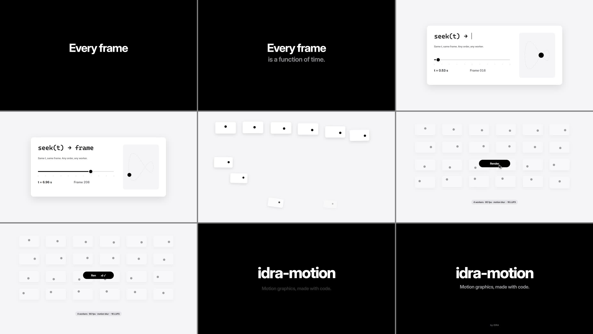

# idra-motion

[](https://github.com/bbrainfuckk/idra-motion/actions/workflows/test.yml)

**Motion graphics, made with code.** A scene is one web page whose every frame is a pure function of
time. idra-motion films it with headless Chrome and ffmpeg, frame-exact, in parallel, with motion blur,
narration, sound effects and synthesised music mixed to broadcast loudness.

It works three ways: as a **skill** and an **MCP server** for AI agents (Claude Code, Codex, Claude
Desktop, Cursor), or by hand from the command line.



[`media/hello.mp4`](media/hello.mp4): the 10 second example in `examples/hello`, rendered with this repo.

## Made from one prompt

The [LetAIApply launch trailer](https://www.youtube.com/watch?v=0TXt47MJRPY) (54.5 seconds, one HTML
file, rendered on a laptop in about seven minutes) came from a single brief to an AI coding agent: the
product, permission to add narration, and full creative freedom.

From that one brief, the agent wrote the beat sheet, made the narration in three ElevenLabs voices to
choose from, rebuilt the product's screens in HTML, checked stills at every beat, and rendered the
master and a web cut. The first cut was complete. Five short notes after watching it made the final
one (what each note changed is in [docs/one-shot.md](docs/one-shot.md)).

idra-motion is that method, packaged so your agent can do the same.

### The prompt

Install it (below), then give your agent one brief like this:

```text
Make a 45 second launch trailer for <product> (<its site or store link>) with idra-motion.
Use the product's own name, logo, colours and font, and only say what it really does.
Add narration: make two or three voices and let me pick.
You have full creative freedom.
```

The skill carries the rest: beat sheet first, every spoken word shown on screen as it is said, stills
at every beat before rendering. With the MCP server, the same brief is built in as `make_trailer`.

## Install

Every way needs Node 20+, Chrome or Edge, and ffmpeg (`winget install Gyan.FFmpeg`,
`brew install ffmpeg`, `sudo apt install ffmpeg`). Narration also needs Python 3 and an ElevenLabs
key ([docs/narration.md](docs/narration.md)). No `npm install`: there are no dependencies.

### Claude Code: skill and MCP server in one step

```text
/plugin install idra-motion --marketplace bbrainfuckk/idra-motion
```

Or from a terminal:

```bash
claude plugin marketplace add bbrainfuckk/idra-motion
claude plugin install idra-motion@idra-motion
```

Then ask for a video. The skill loads by itself (or type `/idra-motion:idra-motion`), and the tools
appear under `/mcp`.

### Codex

```bash
git clone https://github.com/bbrainfuckk/idra-motion
codex mcp add idra-motion -- node /full/path/to/idra-motion/mcp/server.mjs
```

For the skill, copy `skills/idra-motion` into `~/.codex/skills/`, or ask Codex: "install the skill at
https://github.com/bbrainfuckk/idra-motion/tree/main/skills/idra-motion".

Codex asks before each MCP tool call. To let idra-motion's tools run without asking (and for
`codex exec`, which can't ask and blocks them otherwise), add one line under the server in
`~/.codex/config.toml`:

```toml
[mcp_servers.idra-motion]
command = "node"
args = ["/full/path/to/idra-motion/mcp/server.mjs"]
default_tools_approval_mode = "approve"
```

Codex gives a tool call 60 seconds by default. idra-motion answers before that: a long render returns
a job id, and the agent calls `job_status` until it finishes. Nothing to change.

### Claude Desktop, Cursor and other MCP apps

Clone the repo and add the server to the app's MCP config (Claude Desktop:
`claude_desktop_config.json`, then restart it):

```json
{
  "mcpServers": {
    "idra-motion": {
      "command": "node",
      "args": ["/full/path/to/idra-motion/mcp/server.mjs"]
    }
  }
}
```

Without the plugin, Claude Code takes the same server with
`claude mcp add idra-motion --scope user -- node /full/path/to/idra-motion/mcp/server.mjs`.

### The ElevenLabs key

Put `ELEVENLABS_API_KEY=<your key>` in a `.env` file in your project folder or the idra-motion folder
(git ignores it), or set it as an environment variable before starting the app. Never paste the key
into a chat. Where the key comes from, and the free TTSWP credits the trailer used instead, are in
[docs/narration.md](docs/narration.md).

## The MCP tools

| Tool | What it does |
| --- | --- |
| `guide` | The method, the engine API, a finished example, the one-shot prompt. |
| `new_scene` | Starts a scene from the starter template, at your size and length. |
| `preview` | A local link to scrub and play the scene in a browser. |
| `stills` | Films frames at the times you give and **shows** them as one contact sheet. |
| `render` | Draft (30 fps), master (60 fps, motion blur) or web cut, with sound at -16 LUFS. |
| `soundtrack` | The mix alone, or one bus (narration, effects, music). |
| `job_status` | Waits for a long render, or stops it. |
| `voices`, `make_voice` | ElevenLabs voices and one MP3 per narration line. |
| `level_voice`, `word_timings` | Even loudness, and when every word is said (Whisper). |

`npm test` drives the server like an MCP client: handshake, every tool, a real render, stopping one,
and cleanup.

## Quick start by hand

```bash
npm run preview                  # open the printed URL: drag the bar to scrub, Space to play
npm run stills                   # a contact sheet of key frames, in seconds
npm run draft                    # 30 fps with sound
npm run master                   # 60 fps with motion blur
```

Or call the renderer directly:

```bash
node render.mjs examples/hello/scene.html out/check.jpg --stills 0.9,3.6,6.4,9.9
node render.mjs examples/hello/scene.html out/draft.mp4 --fps 30 --workers 4
node render.mjs examples/hello/scene.html out/master.mp4 --fps 60 --subframes 4
node render.mjs examples/hello/scene.html out/mix.wav --audio            # the soundtrack only
```

`FFMPEG=<path>` if ffmpeg isn't on PATH; `--browser <path>` if Chrome or Edge isn't found.

## The one idea

```js
film({
  duration: 10,
  draw(t) {                                      // the whole frame, from t alone
    const k = spring(t - 0.3);                   // arrives at 0.3 s, overshoots a touch, settles
    title.style.transform = `translateY(${lerp(50, 0, k)}px)`;
    typed(code, "seek(t) → frame", t, 2.95, 16); // types from 2.95 s at 16 characters a second
  },
  async sound(ctx) {                             // the soundtrack, from the same times
    const m = mix(ctx);
    await m.keys(2.95, 15, 16);                  // a key tick under every typed character
    m.pad(2.55, 2.45, 10);                       // music under it all
  }
});
```

No CSS transitions, no timers, no state between frames. Same `t`, same frame: any order, any worker.

## What's in here

| Path | What it is |
| --- | --- |
| `engine/motion.js` | Time helpers: `spring`, `track`, `ease`, `kf`, `seg`, `typed`, `count`, `cam`, `rng`, ... |
| `engine/sound.js` | The soundtrack: narration, effects and music buses, ducking, key ticks, drone, pad. |
| `engine/stage.js` | `film(...)`: wires a scene for the renderer and gives the browser a scrubber. |
| `render.mjs` | The renderer: stills, sound only, or the full MP4 at -16 LUFS. |
| `mcp/server.mjs` | The MCP server: the renderer, the narration tools and the method as agent tools. |
| `skills/idra-motion/` | The method as a skill for Claude Code, Codex and other agents. |
| `.claude-plugin/` | The Claude Code plugin and marketplace (skill and MCP server together). |
| `tools/vo.py` | Narration: ElevenLabs voices and lines, levelling, word timings (faster-whisper). |
| `tools/ttswp-say.php` | Narration from TTSWP credits, run with WP-CLI on a WordPress site. |
| `tools/serve.mjs` | The preview server. |
| `.env.example` | Where your ElevenLabs key goes: copy it to `.env` (git ignores `.env`). |
| `sfx/` | Six sound effects (whoosh, click, pop, riser, impact, tick), made by `tools/make-sfx.mjs`. |
| `tools/make-sfx.mjs` | Builds the sound effects from noise, tones, filters and envelopes. |
| `fonts/` | Inter (SIL Open Font License). |
| `examples/starter/` | The scene `new_scene` copies: title, typed line, camera drift, sound. |
| `examples/hello/` | A finished 10 second example with sound. |
| `docs/one-shot.md` | The method, with the LetAIApply trailer as the worked example. |
| `docs/narration.md` | The voice: ElevenLabs key setup, the free TTSWP credits, Whisper word timings. |
| `tests/mcp.test.mjs` | Drives the MCP server end to end (`npm test`). |

## Make your own

1. Write the beat sheet: one narration line per row, what is **seen** and **heard** at each.
2. Narration first, if any ([docs/narration.md](docs/narration.md)), then time the picture to the words.
3. Start from `examples/starter/scene.html` (or `new_scene`), build each part as a time window inside `draw(t)`.
4. Stills at every beat; read each frame against the script; fix; repeat.
5. Draft, then master.

The two rules that made the trailer land: whatever is said visibly happens on screen at that moment,
and the text on screen is the exact word being said.

## Licence

Source available, not open source ([LICENSE](LICENSE)). You may read idra-motion and run it, unmodified,
to make your own videos, for personal or commercial work, with no fee, including through an AI agent
with the skill and the MCP server. The videos are yours. You may not copy, change, share, sell, host or
rebuild idra-motion itself. For any other use, write to marvin@idra-ai.com.

## Credits

Made by Marvin Sarreal Villanueva at [IDRA](https://idra-ai.com). The sound effects and the music are
synthesised by idra-motion itself; the font is Inter. Details in [CREDITS.md](CREDITS.md).
